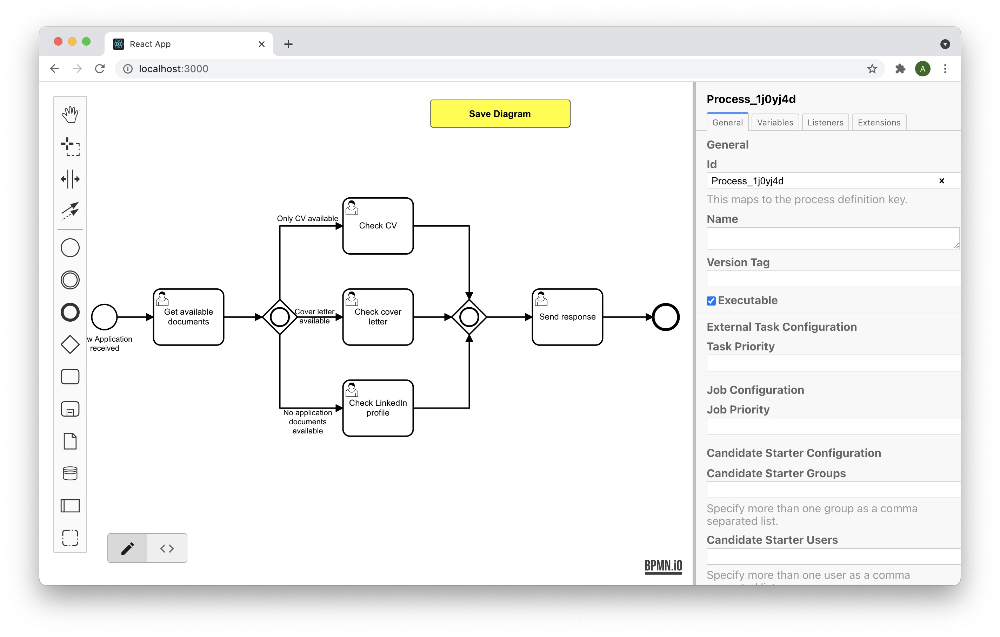

# Camunda Web Modeler

[](https://www.npmjs.com/package/@miragon/camunda-web-modeler)
[](https://github.com/Miragon/camunda-web-modeler/actions/workflows/build.yaml)
[](LICENSE)



**Let the users of your app model BPMN processes and DMN decisions without leaving it.**

A React component with the [bpmn.io](https://bpmn.io) modelers, the Camunda 7 properties
panel and an XML editor. Before 1.0, minor versions can break; see
[MIGRATION.md](MIGRATION.md).

## Why

Wiring bpmn-js or dmn-js to properties panels, Camunda extensions and an XML view takes
lots of glue code. This library is that glue, behind one component per notation.

## What you get

- **BPMN and DMN.** `<BpmnModeler>` and `<DmnModeler>` each come with canvas, properties
  panel and XML editor; for DMN, the panel covers the decision requirements diagram.
- **Camunda 7 ready.** The panel edits the Camunda 7 attributes, and element templates in
  the Camunda 7 format plug right in. Camunda 8 (Zeebe) is not built in.
- **XML editor on demand.** Monaco loads only when users open the XML view.
- **Typed events and full access.** Every change arrives as a typed event, and a `ref`
  hands you the underlying bpmn-js or dmn-js modeler.
- **React and Vue.** React 17 to 19, or Vue 3 through the BPMN
  [wrapper component](examples/vue-vite/BpmnModeler.vue) you copy into your app.

## Install

You need a bundler such as Vite, webpack 5 or Next.js, or an import map as in the
[example without a build step](examples/react-cdn).

```sh
npm install @miragon/camunda-web-modeler monaco-editor
# or
yarn add @miragon/camunda-web-modeler monaco-editor
```

## Get started

This setup uses Vite; for server-side rendering, see the [guide](docs/guide.md).

1. Register Monaco's worker in `monaco-worker.ts` and import it first in your entry file
   (`import "./monaco-worker";`):

   ```ts
   import EditorWorker from "monaco-editor/editor/editor.worker?worker";

   self.MonacoEnvironment = { getWorker: () => new EditorWorker() };
   ```

2. Import the stylesheet and render the modeler in an element with a height:

   ```tsx
   import {
     BpmnModeler,
     isContentSavedEvent,
     ModelerEvent,
   } from "@miragon/camunda-web-modeler";
   import "@miragon/camunda-web-modeler/style.css";
   import React, { useCallback, useState } from "react";

   // Your BPMN 2.0 XML, e.g. loaded from your backend.
   const BPMN = `<?xml version="1.0" encoding="UTF-8"?>...`;

   const App: React.FC = () => {
     const [xml, setXml] = useState(BPMN);

     const onEvent = useCallback((event: ModelerEvent) => {
       if (isContentSavedEvent(event)) {
         setXml(event.data.xml);
       }
     }, []);

     return (
       <div style={{ height: "100vh" }}>
         <BpmnModeler xml={xml} onEvent={onEvent} />
       </div>
     );
   };

   export default App;
   ```

3. Replace `BPMN` with your diagram XML and start your app: the diagram opens, and every
   edit lands in `xml`.

Next: the [guide](docs/guide.md) and the [examples](examples).

## Help and feedback

- **Documentation:** setup, options and API reference in the [guide](docs/guide.md).
- **Bugs and questions:** [open an issue](https://github.com/Miragon/camunda-web-modeler/issues)
  with logs, screenshots and a code example.
- **Professional support:** write to
  [info@miragon.io](mailto:info@miragon.io).

## Contributing

How to build, test and change the project is in [CONTRIBUTING.md](CONTRIBUTING.md).

## License

[Apache 2.0](LICENSE), Copyright 2021 FlowSquad GmbH. The bpmn.io license applies as well:
keep the bpmn.io logo in the bottom-right corner of the canvas.
